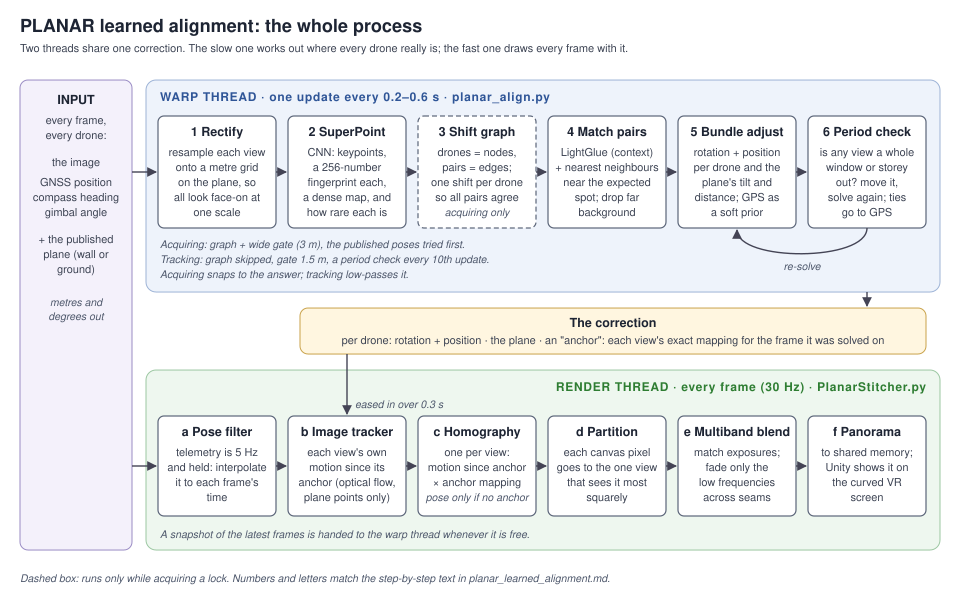

# PLANAR learned alignment: what changed, and the case for end-to-end learning

2026-11-13, updated 2026-11-15. The PLANAR stitcher mosaics the drones' views of one plane, a facade or the
ground, with one homography per view built from each drone's pose. That pose comes from GNSS, the compass and a
gimbal, and it is metres and degrees out. The stitcher therefore left 10–40 px seams on the recorded real-drone
clips. This note explains how the new method works, summarises what was built and how it was measured, and then
assesses end-to-end learning as the next step. The engineering detail is in [CLAUDE.md](../CLAUDE.md) under
"PLANAR learned alignment".

## How it works

**The idea in one paragraph.** If every drone's position and orientation were known exactly, each view could be
projected onto the wall (or the ground) with one homography and the views would line up perfectly; that is what
the old stitcher did with the GPS pose. The error is in the pose. So the method looks for the same points of the
wall in neighbouring views, and solves for the small rotation and position correction per drone, plus the true
plane, that make all of those points land in the same place. GPS stays in as a soft prior, so where the images
say nothing the drones stay where GPS put them. This solve is too slow for every frame, so it runs on its own
thread a few times a second, and the render thread carries its answer forward using each view's own image motion.

The two threads share one correction. They are the same split StabStitch++ uses here: the expensive estimate is
computed separately from the rendering, and the rendering never waits for it.

### The warp thread (`planar_align.py`), a few times a second

**1. Rectify.** Every view is resampled onto a grid laid out on the plane, in metres (about 5 cm per pixel at
30 m), using the current best pose. After this every view looks at the wall face-on and at the same scale, and
a point of the wall appears at nearly the same grid position in every view, off only by what the pose error
moves it. That turns the hard problem (matching across different viewpoints, distances and headings) into an
easy one (finding a displacement of a metre or two). It is also why nadir views with arbitrary headings can be
matched by a detector that is not rotation invariant: the rectification has already rotated them into one frame.

**2. SuperPoint** is a small convolutional network that runs once per rectified view and gives three things:
- *keypoints*: points it is confident it could find again in another picture, mostly corners and blobs;
- *a descriptor* for each: 256 numbers summarising the patch around the point, built to be the same for the same
  bit of wall under a different exposure, blur or slight viewpoint, and different for anything else. Two
  descriptors are compared by their dot product (cosine similarity, 1 = identical);
- *a dense descriptor map*: the same kind of fingerprint for every 8×8-pixel cell of the image, which steps 3
  and 6 use to compare whole images rather than single points.

Each cell also gets a *distinctiveness* weight: how few look-alikes it has in its own image. On a facade of
identical panels almost every cell looks like hundreds of others and votes for every possible alignment equally;
a door, a different window or the end of the building has none, and is what can tell the alignments apart. This
is inverse document frequency from text search, with the image as the corpus.

**3. Shift graph** (only while acquiring a lock). For each pair of overlapping drones, the two dense descriptor
maps are slid over each other and scored at every relative shift up to 6 m, giving a score surface per pair. On a
repeating wall a single surface has several equally good peaks, a panel apart. The graph treats the drones as
nodes and the pairs as edges and picks one shift per drone so that all the pairs agree at once, with GPS as a
cost for moving a drone from where it was published. Loops are what make it work: if A–B and B–C are each
confident, the A–C pair's ambiguity is settled by them. The result is only a starting point for step 4.

**4. Match pairs.** Two matchers run on every overlapping pair, and their matches are pooled:
- *LightGlue* is a transformer network that takes both sets of keypoints (positions and descriptors) and decides
  which point in one image is which point in the other. It works in layers. In each, every keypoint first looks
  at the other keypoints *in its own image* (self-attention), which lets it describe itself by its context, "the
  corner of the third window from the left", not just by its own patch. It then looks at the keypoints *in the
  other image* (cross-attention), which lets candidates on both sides compare notes. After the last layer it
  scores every possible pairing, adds a "matchability" score for each point (a point the other image simply does
  not show should stay unmatched), and keeps the pairings that are each other's best choice. It was trained on
  millions of photo pairs with known geometry. Its strength is that context: on varied texture it finds several
  times more correct matches than comparing descriptors alone. Its weakness here is that it knows nothing about
  where we expect a match to be. On identical storeys the context is identical too, and between the two rows of
  the simulated wall it matched every point two storeys out, even with perfect poses.
- *Gated nearest neighbours* answer the question LightGlue cannot be asked: "given that the drones are about
  here, which point corresponds?" For each keypoint, only the keypoints of the other view within 1.5 m (3 m while
  acquiring) of where the current alignment predicts are considered, and the most similar one is kept if the
  choice is mutual and the descriptors agree (cosine above 0.7). Since 1.5 m is under half a window spacing,
  each point has one candidate and it is the right one.

Matches displaced along the pair's baseline by more than 60% of the baseline are set aside: they are far
background (a skyline, the building behind), which would otherwise "align" by faking metres of pose error.

**5. Bundle adjustment.** The unknowns are a 3-D rotation and a 3-D position correction per drone, plus the
plane's tilt (two angles) and its distance. For every match, the pixel in view *i* is traced as a ray to the
plane, and the point it hits is projected into view *j*; the error is how far that lands from the matched pixel
(and the same the other way round). The solver (Levenberg–Marquardt) adjusts all unknowns together to make
those errors small, while GPS, compass, gimbal and the published plane pull towards their own values with their
own uncertainty (2.5 m horizontally, 2 m vertically, 5° of heading, 2° of gimbal, 12° and 6 m for a plane
derived from the formation). Two details matter:
- *The error is split in two directions.* A point that is not on the plane (a balcony, a roof, a tree) moves
  only along one direction in the other view as its depth changes: the epipolar direction. Across it, every match
  tests the cameras whatever it lies on, so it is always listened to. Along it, a match only tests whether the
  point is on the plane, so once it is clearly off the plane it is ignored.
- *The tolerance starts loose and tightens* (30 px down to 2.5 px), so the first iterations move towards the
  bulk of the matches and the last ones listen only to matches that agree to a couple of pixels. Wrong matches
  lose their say without ever being explicitly labelled as wrong.

**6. Period check.** The solution is used to rectify the views again. Each pair's dense descriptor maps are then
compared over every relative shift (as in step 3, computed by Fourier transform so it takes milliseconds). With
the views registered, a wrong storey shows up plainly wherever the wall has anything that does not repeat: in the
simulated wall the right alignment between two drones of one row scores 0.67 and the next window over 0.50–0.55.
If moving some views by a whole period fits better, they are moved and the bundle adjustment is run again from
there with the gated matcher only; the move is kept only if it keeps most of the inliers and no view loses its
support. Where the images cannot tell the alignments apart (the two rows of the simulated wall see identical
storeys), each view goes to the candidate nearest where GPS put it.

**Acquire, then track.** The first solve, and any solve after the lock is lost, is an *acquisition*: published
poses first, the shift graph if they do not explain the matches, the wide gate, and the answer is applied at
once. After that the aligner *tracks*: the graph is skipped, the gate is 1.5 m, each answer is low-passed so the
mosaic does not shimmer, and every tenth update re-runs the period check, moving a view only on decisive image
evidence. That last check is what stops a wrong lock from defending itself: its own matches always lie within
its own gate.

### The render thread (`PlanarStitcher.py`), every frame

**a. Pose filter** (`planar_pose_filter.py`). DJI telemetry arrives about five times a second and is repeated in
between, so the position moves in steps. Each drone's samples are interpolated to the moment its frame was
taken.

**b. Image tracker** (`planar_track.py`). Each solve records an *anchor* for every view: its exact mapping for the
frame the solve used. From then on, each view's own motion since that frame is measured from the images
(optical flow on a few hundred points, fitted with a robust affine transform), using only points that move the
way the plane does. This is what makes it hold together in flight: each drone's video arrives with its own,
varying delay (one ran about 1 s behind on a weak link), so the telemetry for "now" is the wrong pose for the
picture on screen, whereas the picture's own motion is always the right one.

**c. Homography.** Each view is drawn with its motion since the anchor times its anchor mapping. A view with no
anchor yet, or one older than 2.5 s, is drawn from its corrected pose instead. A new solve is eased in over
0.3 s rather than snapped to.

**d. Partition.** Each canvas pixel is taken from exactly one view, the one that sees that point of the wall most
squarely. With one source per pixel nothing can ghost.

**e. Multiband blend.** Each drone's auto-exposure differs, so a hard partition shows brightness steps. A gain
per drone is solved to match the overlaps, and then only the low frequencies (overall brightness) are
cross-faded across the seams; the detail stays from one view.

**f. Panorama.** Written to the shared-memory map that Unity reads and shows on the curved VR screen.

## Results

Each clip is streamed at frame rate through `tools/planar_stream_bench.py`, and the estimators' answers arrive as
late as they really took to compute. The table gives the plane-supported seam in source pixels, median per clip.
It is measured with ORB, a detector the new method does not use.

| Recorded clip | Pose only | Previous estimators | New |
|---|---|---|---|
| MED facade, 3 drones (1) | 13.4 | 19.6 | **2.1** |
| MED facade, 3 drones (2) | 9.8 | 39.4 | **2.1** |
| MED facade, 5 drones | 41.7 | 14.9 | **4.3** |
| Grass nadir, flown | 37.0 | 5.6 | **1.8** |
| Grass nadir, contracting | 40.7 | 9.0 | **1.8** |
| Nadir, 6 drones, 30 m | 42.8 | 6.4 | **1.8** |
| Nadir, 6 drones, 40 m | 35.3 | 6.1 | **1.5** |

- **Shimmer:** the views moving against each other from frame to frame fell from 0.4–1.9 px to 0.03–0.35 px on
  six of the seven clips.
- **5-drone clip:** it is 3.7 px with 0.9 px of shimmer while the drones face the wall. It degrades in its last
  4 s, when the formation climbs past the roofline and the facade leaves the frame.
- **MED floor:** about 2 px there is the building itself. Its louvre panels stand 0.5–1 m proud, and even a free
  homography per pair cannot do better.
- **Simulated clips with injected error** (1 m / 1.5° of pose error, two draws per clip; recorded headless in
  ScenicPatchCityWorld). These have exact poses, so they are scored by how far the views sit from their true
  places, in source pixels:

  | Simulated clip | Pose only | Previous estimators | New |
  |---|---|---|---|
  | Wall of windows, 6 drones | 35–52 | 33–44 | **2.9–3.9** |
  | Nadir over a junction, 6 drones | 23–38 | 9–25 | **4.1–6.7** |
  | Nadir over open ground, 6 drones | 26–44 | 8–18 | **4.9–8.1** |

  **Correction (2026-11-15):** the first version of this note gave 2–5 px for these clips from the seam measure.
  On the wall that was wrong: the seam measure cannot see a view placed a whole window or storey out, and several
  were, by 3–6 m. That has been fixed (contribution 2) and the wall is now scored against the true poses. Across
  twelve draws of the error it ends a median 2.9 px from truth, worst 11 px.
- **Examples:** three-way stills (pose only / previous estimators / new, same instant) for every clip are in
  `D:\claude_planar_sim2\results\fix_cmp3_*.jpg`, outside the repo.
- **Cost:** one update takes 0.2 s for 3 drones and 0.5–0.6 s for 6, on the warp thread; the first lock on 6
  views takes about 2 s. The render path grows
  from 5 to 11 ms a frame for 3 views and from 11 to 17 ms for 6 (RTX 4090).
- **Not yet tested:** none of this has run live in Unity or on aircraft.

## Contributions

1. **Learned matching and a planar bundle adjustment** (`planar_align.py`).
   - Each view is rectified onto the prior plane first, which removes viewpoint, scale and rotation. SuperPoint and
     LightGlue then match the overlapping pairs.
   - One solve recovers a rotation and a position correction per drone **and the plane's orientation**. The plane
     tilt (5–6° on MED) was the largest real error, and the old estimators could only change the plane's distance.
   - The published poses enter as Gaussian priors.
   - The robust kernel is split along and across each match's epipolar direction. Off-plane content then cannot
     drag the poses.
2. **A view graph for repeating facades.** The drones are nodes, GPS is the prior on each node, and every
   overlapping pair is an edge scored by the views' dense learned descriptors. One shift per drone is chosen so
   that all the pairs agree, and the loops resolve what single pairs cannot.
   - Rare descriptors outweigh repeated ones.
   - A shift pattern proportional to the drones' positions is recognised as "a different surface", not as pose
     error.
   - The published geometry wins unless the images clearly overrule it. On a wall of identical windows the images
     cannot.
   - **Added 2026-11-15, after the simulated wall failed (below):** every pair is also matched by nearest
     neighbours restricted to the alignment being tested, and every solution is checked for views a whole window
     or storey out. That check compares the registered views' dense descriptors over shifts. Where the wall has
     anything that does not repeat it picks the one alignment that fits; where it has nothing, each view goes to
     the candidate nearest its GPS position.
3. **Alignment carried by the images, not the telemetry** (`planar_track.py`).
   - The problem: one drone's video ran about 1 s behind the others on a weak link. Each frame was drawn at its
     telemetry pose, so that view slid 1.5 m off whenever the formation moved.
   - The fix: each solve is pinned to the frames it used, then carried forward by each view's own frame-to-frame
     image motion. This motion is restricted to points moving as the plane does.
   - This is MViS's structure: inter-view transforms tie the views together and temporal transforms tie each view to
     its past. Here the temporal half is measured instead of fitted.
4. **Telemetry resampling** (`planar_pose_filter.py`). The pose is sampled at about 5 Hz and held in between; it is
   interpolated to each frame's time.
5. **`Multiband` blend.** Each drone's exposure is matched to its neighbours', and the low frequencies are
   cross-faded. Detail still comes from one view, so nothing ghosts. This is DJIScene's setting.
6. **Measurement tools.**
   - `tools/planar_stream_bench.py` plays real or simulated clips in real time, with `--pose-noise` and `--video`.
   - `PlanarCaptureProbe.cs` records simulated clips with exact poses, headless.
   - Self-test section 13 covers the solver, the graph, the blend, a synthetic repeating facade and a lagging video.

**Switching it on:** the existing inspector switches `planarPoseRefine` and `planarPlaneSweep` now drive all of this.
`PLANAR_LEGACY_ESTIMATORS=1` restores the photometric estimators.

**Known limits:**
- With exact simulated poses the aligner can only add noise (1.4–3.7 px), so leave the switches off in the sim.
- Content off the plane still breaks at seams.
- Where a wall repeats with nothing to tell its periods apart (two rows of drones looking at identical storeys),
  the choice of period falls to GPS. It is then right only while the GPS error between the rows is under half a
  storey.

## End-to-end learning: feasibility, pros and cons

**Formulation.** The unknowns are small:
- a correction `(ω_i, t_i)` per drone;
- the plane `(n, d)`;
- optionally a residual height field `h(a, b)` on the plane, for parallax.

The training objective, with no labels, is

    L = Σ_(i,j) Σ_overlap ρ( I_j(H_j⁻¹ H_i x) − I_i(x) )          photometric / feature agreement
      + Σ_i ‖(ω_i, t_i)‖²_Σ_GNSS                                   noisy GPS and compass as a prior
      + λ_t Σ_i ‖θ_i(t) − θ_i(t−1) − Δ_i(t)‖²                      temporal consistency with measured image motion
      + λ_h ‖∇h‖²                                                    a smooth surface

Here `H_i = K R_i [e1 | e2 | O − C_i]` is built from the predicted parameters. Every output is therefore a valid
homography, and all of them are consistent by construction. MViS's per-view free homographies are neither, and
StabStitch++'s meshes are neither.

A network `f(images, GPS) → (ω, t, n, d, h)` trained on L generalises what this pipeline now does with hand-set rules.

**The most practical form** keeps the current solver and learns only its parts:
- the per-match and per-pair weights;
- the "which alignment" decision on repeating facades;
- a few unrolled Gauss–Newton steps with learned features.

The geometry stays exact and inspectable, and only the judgement calls are learned.

**Pros**
- One forward pass at a fixed cost. It could run every frame and drop the anchor bookkeeping.
- It can learn what makes a facade unambiguous (windows, edges, the roofline) instead of relying on tuned
  thresholds.
- It could output a height field or mesh, which is the one thing the plane model cannot express. That would remove
  the parallax seams on roofs and background.
- Graph neural networks fit naturally: drones are nodes, GPS baselines are edge features, and overlap is the
  adjacency. Inference already scales to N views, and LightGlue's attention is itself a graph network.

**Cons**
- **Data is the binding constraint.** There are seven usable real clips from two sites. Any end-to-end model would
  memorise them.
- It fails silently on an unfamiliar site, and when it is wrong there is nothing to inspect.
- Sim-to-real gap: the simulated facades (rendered rooms behind each window) are harder than the real one in some
  ways and easier in others.
- It competes with the VR renders for the same GPU. The current per-frame budget is already 11–17 ms.

**Distilling StabStitch++ or MViS instead**
- *MViS:* it is per-video test-time optimisation (Adam over a small network, 0.5–0.8 s per frame per view). The new
  pipeline is in effect its real-time counterpart, so nothing geometric is left to distil. Its slow RoMa matcher
  could serve as an offline teacher for a fast matcher.
- *StabStitch++:* its pairwise mesh network is the missing parallax model. To extend it to N views, apply it to the
  view graph's edges and solve for per-view meshes that agree across the loops, the same way the shift graph is
  solved. Then distil that into a single network. That is weeks of work plus training data.

**Recommended path**
1. **Fly and record more:** more sites and formations, logging the video latency. Every new clip yields
   pseudo-labels for free from the current solver, and `PlanarCaptureProbe` gives unlimited exact labels in
   simulation.
2. **Replace the hand-set selection rules with small learned models**, trained on the current solver's outputs.
3. **Add a height field or mesh head** for off-plane content.
4. **Attempt full end-to-end only once a multi-site dataset exists.**
